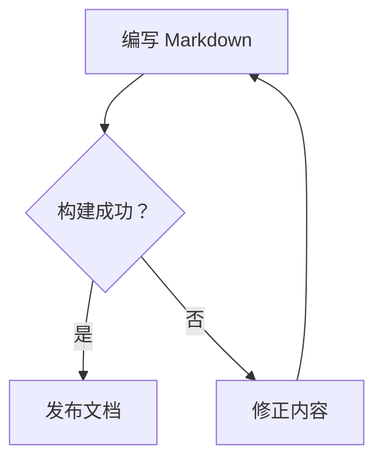
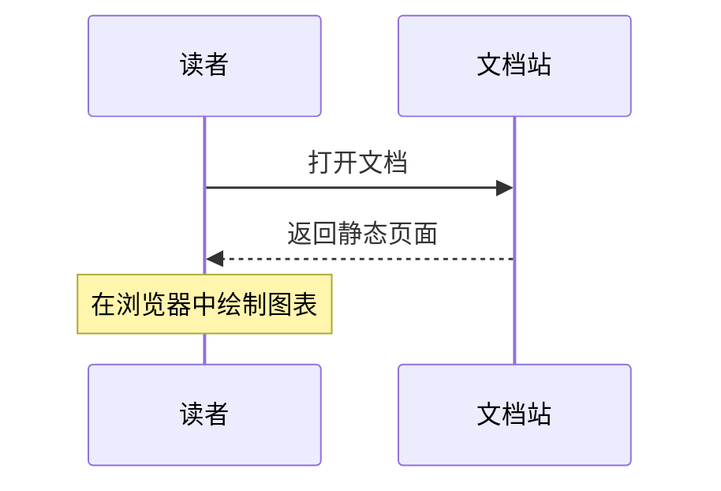

# Markdown 编写指南

本站支持 CommonMark、GitHub 风格 Markdown，以及代码高亮、Mermaid 图表和 LaTeX 公式。本文中的示例也是渲染效果预览。

## 代码高亮

在围栏代码块的开头标明语言，即可高亮。语言名不区分大小写；支持 C、C++、Java、C#、Bash、JavaScript、TypeScript、Python、Go、Rust、SQL、JSON、YAML、HTML、CSS、PowerShell 等语言。

````markdown
```cpp
#include <iostream>

int main() {
    std::cout << "Hello, XINGJI!" << std::endl;
    return 0;
}
```
````

### C 与 C++

```c
#include <stdio.h>

int main(void) {
    printf("Hello, XINGJI!\n");
    return 0;
}
```

```cpp
#include <iostream>

int main() {
    std::cout << "Hello, XINGJI!" << std::endl;
    return 0;
}
```

### Java 与 C#

```java
public class Main {
    public static void main(String[] args) {
        System.out.println("Hello, XINGJI!");
    }
}
```

```csharp
using System;

class Program {
    static void Main() {
        Console.WriteLine("Hello, XINGJI!");
    }
}
```

### Bash

```bash
#!/usr/bin/env bash
set -euo pipefail

for file in docs/*.md; do
    printf '%s\n' "$file"
done
```

常用别名有 `cpp` / `c++`、`csharp` / `cs` / `c#`、`bash` / `sh`、`javascript` / `js`、`typescript` / `ts`、`python` / `py`。`shell` 或 `console` 适合包含命令提示符和输出的终端记录。

不标语言、使用 `text` 或填写未知语言时，代码按原文显示。代码中的 HTML 字符会作为文本保留。支持剪贴板访问的浏览器会显示“复制代码”按钮。

## Mermaid 图表

使用语言标记为 `mermaid` 的代码块。图表组件由本站提供，首次打开页面时在浏览器中渲染；只有包含图表的页面会加载组件。图表下方可以展开源码，语法有误或组件加载失败时会保留源码并显示提示。

````markdown

````


也支持 Mermaid 的时序图、类图、状态图、实体关系图和甘特图等图表。



## 数学公式

行内公式使用 `$...$`，例如 `$E = mc^2$` 会显示为 $E = mc^2$。

独立公式使用单独占一行的 `$$` 包围：

```text
$$
\sum_{i=1}^{n} i = \frac{n(n+1)}{2}
$$
```

$$
\sum_{i=1}^{n} i = \frac{n(n+1)}{2}
$$

公式由 KaTeX 在构建时生成，字体也由本站提供。普通文本中需要美元符号时可以写成 `\$`；代码块和行内代码中的美元符号不会被解析成公式。

## 提示块

在引用块开头使用 `[!NOTE]`、`[!TIP]`、`[!IMPORTANT]`、`[!WARNING]` 或 `[!CAUTION]`：

```markdown
> [!TIP]
> 提示块内可以使用 **强调**、链接和列表。
```

> [!NOTE]
> 这里是补充说明。

> [!TIP]
> 提示块内可以使用 **强调**、[链接](README.md)和列表。

> [!IMPORTANT]
> 请关注这项重要信息。

> [!WARNING]
> 执行操作前请检查参数。

> [!CAUTION]
> 请先保存需要保留的数据。

## 表格、任务列表与脚注

| 功能 | 写法 | 状态 |
| :--- | :---: | ---: |
| 删除线 | `~~旧内容~~` | 支持 |
| 自动链接 | `https://example.com` | 支持 |
| 脚注 | `引用[^名称]` | 支持 |

~~旧内容~~ 可以与 **粗体**、*斜体*和 `行内代码`组合使用。

- [x] 支持已完成任务
- [ ] 支持待办任务

脚注引用会链接到文末，脚注后有返回正文的链接。[^example]

[^example]: 这里是脚注内容，可以包含 **强调** 和链接。

## 折叠内容与 HTML

原始 HTML 可以用于折叠内容、上下标、键盘按键等排版：

```html
<details>
<summary>展开查看</summary>

这里可以写 **Markdown**，注意与 HTML 标签之间保留空行。

</details>
```

<details>
<summary>展开查看示例</summary>

这里可以写 **Markdown**。例如水的化学式 H<sub>2</sub>O、平方 x<sup>2</sup>，以及快捷键 <kbd>Ctrl</kbd> + <kbd>C</kbd>。

</details>

## 标题、链接与 Front matter

二至六级标题旁的 `#` 可以复制或打开该标题的锚点。相同标题会获得不同锚点，二至四级标题还会自动进入本文目录。

相对 Markdown 链接（例如 `[首页](README.md)`）会自动转换为站内页面地址，并保留查询参数和锚点；相对图片路径按当前源文件目录解析。

文档开头可放置 YAML Front matter，元数据不会显示在正文中。当前页面标题仍取正文的第一个一级标题：

```yaml
---
title: 示例文档
tags:
  - guide
---
```
